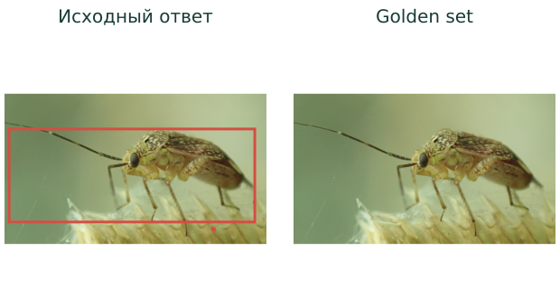

<!-- _class: lead -->
<!-- _paginate: false -->

# Butterfly BBox

Подготовить проверенную разметку бабочек и молей на фотографиях,
сравнить готовые модели и выбрать лучшую для поиска объектов и выделения их рамками.

<!--
10 секунд. Наша задача — получить проверенную разметку бабочек и молей, сравнить готовые модели и выбрать решение для автоматического выделения рамок.
Источник: docs/final_project_2026.md.
-->

---

# Что сделала команда

- Подготовили репозиторий и документацию.
- Собрали фотографии и отобрали рабочую выборку.
- Настроили обучение, экзамен и разметку рамок.
- Организовали независимую проверку ответов.
- Разобрали ошибки и собрали эталонную разметку.
- Сравнили три модели и проверили улучшенный промпт.
- Подготовили предсказания для экзаменационного набора.

<a href="https://github.com/crowd13/butterfly-bbox">Подробнее: проект ↗</a>

<!--
20 секунд. Прошли весь путь от сбора фотографий до файла предсказаний. Сначала подготовили данные и проекты разметки, затем проверили ответы и исправили ошибки. На итоговом наборе сравнили три модели, уточнили промпт и подготовили предсказания для экзамена. Дальше покажем, как устроены эти этапы и что получилось.
Источники: README.md; data/README.md; crowd/bbox/README.md; crowd/review/README.md; golden_set/corrections.pdf; models/modeling.ipynb; submission/submission.jsonl. Отправка и балл Контеста здесь не утверждаются.
-->

---

# Подготовка данных

600 → 593

собрано → отобрано после ручной проверки

400

фотографий в рабочей выборке

CC0

фотографии iNaturalist с сохранёнными источниками

Из 593 отобранных фото зафиксировали **рабочую выборку из 400**.

Состав исходной выборки: **303** целевых · **57** похожих · **40** фоновых

Похожие насекомые и фон помогают проверить, не выделяет ли модель лишние объекты.

<a href="https://github.com/crowd13/butterfly-bbox/tree/main/data">Подробнее: подготовка данных ↗</a>

<!--
40 секунд. Сначала собрали 600 кандидатов; после ручной проверки осталось 593. Для рабочего процесса зафиксировали 400 фотографий. Квоты помогают проверять не только обнаружение, но и ошибки на похожих объектах и фоне. Категория источника не заменяет эталон. Остальные фотографии не следует называть все без исключения контролями: банк эталонов отдельный, 110 примеров. Готовая выборка включает 23 кадра с молями по архитектуре crowd.
Материалы: Источники: data/README.md; crowd/bbox/fixtures/gold/working_manifest.csv; docs/final_project_2026.md
-->

---

<!-- _class: compact bbox -->

# Создание проекта bbox-разметки

<h2>1. Эталоны</h2>
<strong>110 примеров:</strong> 10 для обучения, 10 для экзамена, 90 для контроля.

Черновик модели проверила команда. Обучение — с подсказками.

<h2>2. Экзамен</h2>
<strong>10 изображений, одна попытка.</strong>

Для допуска нужны <strong>9 верных ответов</strong>.

Эталонные ответы скрыты.

<h2>3. Ханипоты</h2>
<strong>1 скрытый контроль</strong> на 4 рабочих кадра.

2 ошибки в последних 5 проверках снимают допуск до разбора.

<strong>Экзамен и контроль: IoU ≥ 0,75</strong> (пересечение / объединение). Рамки сопоставляем один к одному, без пропусков и лишних выделений.

<strong>Результат:</strong> собрали ответы на все 400 фото → независимое ревью. <strong>Выплаты: 270 ₽ без комиссии</strong> — 250 ₽ разметка + 20 ₽ экзамен. <a href="https://tasks.yandex.ru/requester/project/11779">Проект №11779 ↗</a>

<a href="https://github.com/crowd13/butterfly-bbox/tree/main/crowd/bbox">Подробнее: разметка рамок ↗</a>

<!--
65 секунд. Подготовили отдельный банк эталонов: модель сделала черновик, команда проверила и исправила рамки. Эти фото не входят в рабочую выборку. В обучении есть подсказки, экзамен проверяет самостоятельную работу. Для экзамена и скрытых контролей используем один критерий: IoU не ниже 0,75, все объекты найдены, лишних рамок нет. Рамки сопоставляются один к одному; пустой кадр требует ответа «бабочек нет». Python-процесс проверяет ответы через API каждые 30 секунд, пока запущен мониторинг. Получили 400 рабочих ответов: 296 с рамками, 102 без бабочек и 2 сомнения. Все передали на ревью. Выплаты — 270 рублей без комиссии.
Техническая справка, не зачитывать: максимальное паросочетание с увеличивающими путями; совпадение статуса обязательно. Ошибка загрузки и повторный показ контроля требуют разбора. Две ошибки снимают допуск и до заполнения окна. В выгрузке 20 экзаменационных попыток и 100 контрольных ответов; эти числа не означают количество правильных ответов.
Материалы: Источники: crowd/bbox/quality.py; workflow.py; fixtures/gold/report.json; runs/final/{coverage.json, assignments.json}
-->

---

<!-- _class: compact -->

# Создание проекта независимого ревью

400

фотографий с двумя проверками

800

независимых голосов

0

проверок собственной разметки

<strong>Допуск ревьюеров:</strong> обучение, экзамен ≥ 90%; затем скрытые контроли.

Два «ОК» → кандидат на принятие. Замечание или сомнение → ручной разбор.

Исполнитель не проверяет собственную разметку.

<strong>Без комиссии:</strong> пилот — 12 ₽ по выгрузке; основной пул — 108 ₽ по ставке. Экзамен и бонусы не включены; комиссия не подтверждена. <a href="https://tasks.yandex.ru/requester/project/11912">Проект №11912 ↗</a>

<a href="https://github.com/crowd13/butterfly-bbox/tree/main/crowd/review">Подробнее: независимое ревью ↗</a>

<!--
50 секунд. Ревьюер видит весь кадр и проверяет пропуски, лишние объекты и границы рамок. Для него предусмотрены обучение, экзамен с порогом 90% и скрытые контроли. Каждое фото посмотрели два разных исполнителя; по ID проверено, что никто из них не автор рамок. Два положительных голоса ещё не делают ответ эталоном. Замечания, сомнения и ошибки загрузки направляют на ручной разбор. За пилот подтверждены 12 рублей; 108 рублей за основной пул рассчитаны по 144 назначениям и ставке 0,75 рубля. Полного расхода с экзаменом, бонусами и комиссией в сохранённых выгрузках нет.
Справка: 40 фото пилота и 360 основного пула опубликованы отдельно. Текущий допуск ≥80, то есть 4 правильных контроля из последних 5; до пяти контролей действует допуск с экзамена.
Материалы: Источники: crowd/review/README.md; export.py; runs/final/reviews.json; main-6869875/main_review_votes.json; report.json
-->

---

<!-- _class: compact golden -->

# Сборка golden set и исправление ошибок

Ответы с двумя «ОК» дополнительно проверили моделью; спорные просмотрели вручную. <strong>Неоднозначные случаи и исправления обсуждали командой.</strong>

<h2>Нашли пропущенную бабочку</h2>
761222854 · «бабочек нет» → добавили рамку

<h2>Убрали лишние рамки</h2>
762683935 · другое насекомое → пустой ответ

**Эталонная разметка (golden set): 400 фото, 358 рамок, 96 пустых кадров.**

<a href="https://github.com/crowd13/butterfly-bbox/tree/main/golden_set">Подробнее: эталонная разметка и исправления ↗</a>

<!--
45 секунд. По описанию Никиты, даже ответы с двумя «ОК» прошли дополнительную проверку моделью. Ответы с замечаниями просматривали вручную; неоднозначные случаи и исправления обсуждали командой. Помощь модели не считается независимой человеческой проверкой. На примерах слева красные исходные рамки, справа зелёные итоговые. В первом случае нашли пропущенную бабочку, во втором убрали другое насекомое. Решения и опросы команды сохранены в PDF исправлений. Итоговый набор содержит 358 объектов на 400 фотографиях, включая 96 кадров без бабочек.
Источники процесса: самоописание Никиты в переписке, подтверждённые примеры в corrections.pdf. В отчёте указаны 345 пар «ОК/ОК», в сырых голосах — 346; спорную цифру не используем. 96 пустых кадров итоговой разметки — не те же самые 40 фоновых кадров исходного отбора.
Материалы: Процесс — по самоописанию Никиты; примеры — golden_set/corrections.pdf. Рамки: bbox/runs/final/result.json → golden_set/golden_set.jsonl.
-->

---

# Сравнение моделей и выбор лучшей

| Модель / конфигурация | F1@0,5 | F1@0,75 | Precision¹ | Recall¹ |
|---|---:|---:|---:|---:|
| Grounding DINO tiny | 0,5090 | 0,4643 | 0,3677 | 0,8268 |
| OWLv2 base | 0,4251 | 0,3096 | 0,2841 | 0,8436 |
| Qwen3-VL-2B · исходный промпт | 0,7790 | 0,6966 | 0,7043 | 0,8715 |
| **Qwen3-VL-2B · уточнённый** | **0,8540** | **0,7650** | **0,8504** | **0,8575** |

**Выбрали Qwen с уточнённым промптом: лучший F1 на нашей выборке.**

¹ Precision и recall при IoU ≥ 0,5. Все модели проверены на одних и тех же 400 фото.

Precision — доля верных рамок среди предсказанных; recall — доля найденных объектов. F1 учитывает оба показателя; результат зависит от выборки и настроек.

<a href="https://github.com/crowd13/butterfly-bbox/blob/main/models/modeling.ipynb">Подробнее: сравнение моделей ↗</a>

<!--
55 секунд. Три обязательные модели запущены без дообучения. Оценщик максимизирует число допустимых пар при заданном IoU. Детекторы показывают высокий recall, но гораздо больше лишних рамок: низкий precision снижает F1. Qwen даёт лучший баланс в наших настройках. Это не доказательство превосходства Qwen при любых порогах и данных: систематический подбор настроек всех моделей здесь не проведён. Скорость не сравниваем — сводных измерений в сохранённых материалах нет.
Материалы: Источник: models/modeling.ipynb, сохранённые выводы ячеек 4, 6, 8, 10 (нумерация с нуля)
-->

---

# Эксперимент: уточнение промпта Qwen

+0,075

F1@0,5 0,779 → 0,854

131 → 54

лишние рамки (FP) снижение на 59%

46 → 51

пропущенные объекты (FN) небольшой рост

Уточнили инструкцию: включать видимые усики и лапки, учитывать перекрытия,
не достраивать скрытые части и не рисовать повторные рамки.

> Модель стала реже рисовать лишние рамки — за счёт этого вырос F1.

<a href="https://github.com/crowd13/butterfly-bbox/blob/main/models/modeling.ipynb">Подробнее: эксперименты с промптом ↗</a>

<!--
45 секунд. В сравнении двух запусков Qwen изменены PROMPT и RETRY_PROMPT, остальные основные настройки одинаковы. Уточнённая инструкция согласована с правилами человеческой разметки. Улучшение не бесплатно по recall: истинных попаданий стало 307 вместо 312. Тем не менее снижение FP со 131 до 54 повышает итоговый F1. Не приписывать команде заранее сформулированную гипотезу: в ноутбуке она отдельно не записана. Это наблюдение по результатам, не установленная причинная роль каждой фразы промпта.
Материалы: Источник: models/modeling.ipynb, ячейки 8 и 10. FP и FN при IoU ≥ 0,5; (131 − 54) / 131 ≈ 59%.
-->

---

# Подготовка результатов к сдаче

<h2>Разметка и контроль</h2>

Списки фотографий и проверенные примеры.

Код запуска проектов через API, инструкции и тесты.

Исходные ответы, авторы, голоса ревьюеров и отчёт об исправлениях.

<h2>Модели и итоговый файл</h2>

Ноутбук: настройки, код запуска и таблицы метрик.

<strong>Файл предсказаний для 400 экзаменационных фотографий</strong>: каждый ID один раз, рамки в допустимом диапазоне.

Если модель отвечает в неверном формате, код автоматически повторяет запрос.

<a href="https://github.com/crowd13/butterfly-bbox/tree/main/submission">Подробнее: итоговые предсказания ↗</a>

<!--
40 секунд. Самостоятельно проверены 400 уникальных ID, диапазон и положительная площадь рамок, отсутствие error. Это проверка структуры сохранённого submission; экзаменационного manifest в репозитории нет, поэтому отдельно соответствие всем выданным ID сейчас не доказано. Код ноутбука предусматривает такую проверку. Балл и квитанция Контеста в репозитории не сохранены, поэтому их не показываем. Не обещаем полную воспроизводимость чисел: отдельные файлы предсказаний моделей и закреплённые ревизии весов отсутствуют в закоммиченных артефактах.
Материалы: Источники: crowd/bbox/README.md; crowd/review/README.md; models/modeling.ipynb; submission/submission.jsonl
-->

---

<!-- _class: lead compact -->

# Вклад участников проекта

**Яна Фитковская** — собрала 600 CC0-фотографий и отобрала 593; подготовила классы, скрипты сбора, интерфейс проверки и документацию.

**Даниил Пересторонин** — подготовил репозиторий; разработал и запустил bbox-проект с обучением, экзаменом и контролем качества, собрал разметку 400 фото.

**Данила Шпак** — проверил датасет и эталоны; разработал независимое ревью, настроил и запустил его через API, собрал результаты и проверил работоспособность.

**Никита Созон** — подготовил golden set и отчёт об исправлениях; сравнил три модели, улучшил промпт и получил предсказания для экзаменационного набора.

**Результат команды: 400 фото с эталонной разметкой и выбранная модель.**

<a href="https://github.com/crowd13/butterfly-bbox/commits/main/">Подробнее: история работы над проектом ↗</a>

<!--
30 секунд. Яна подготовила исходные данные и инструменты отбора. Даниил реализовал первичную разметку и контроль исполнителей. Данила организовал независимое ревью. Никита собрал итоговый эталон, сравнил модели и подготовил предсказания. Проверка эталонов и обсуждение спорных случаев были совместной работой. Результат команды — 400 фотографий с эталонной разметкой и выбранная конфигурация Qwen с F1 0,854. Далее — вопросы.
Источники: самоописания Яны, Данилы и Никиты в переписке; git log; PR #9, #11, #12, #15, #16. Самоописания уточняют участие в ручной проверке. Факт отправки в Контест здесь не утверждается: в репозитории подтверждён файл submission. Общий тайминг — 410 секунд плюс 10 секунд на переходы.
-->

---
<!-- _class: lead -->

# Спасибо за внимание!

## Готовы ответить на вопросы

[Код и материалы проекта ↗](https://github.com/crowd13/butterfly-bbox)

[Проект bbox ↗](https://tasks.yandex.ru/requester/project/11779) · [Проект review ↗](https://tasks.yandex.ru/requester/project/11912)

<!--
10 секунд. Поблагодарить слушателей и перейти к вопросам. Оставить этот слайд на экране.
-->
